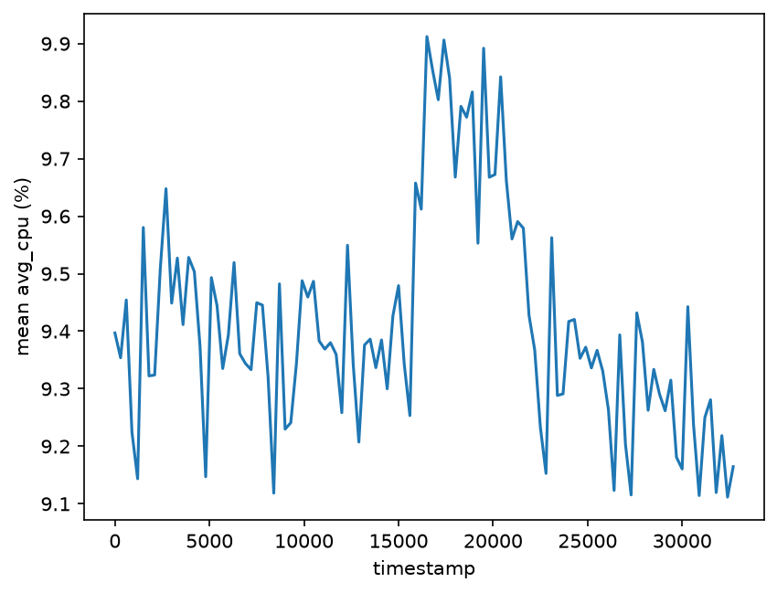
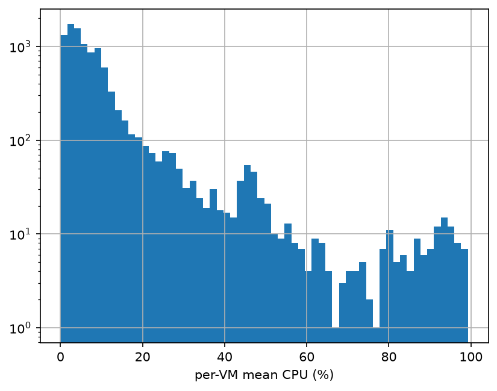
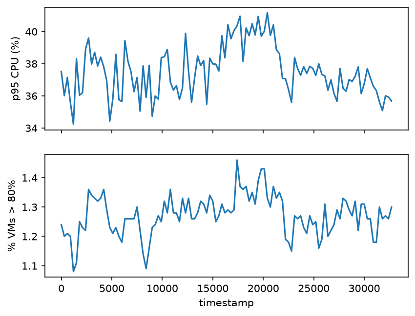
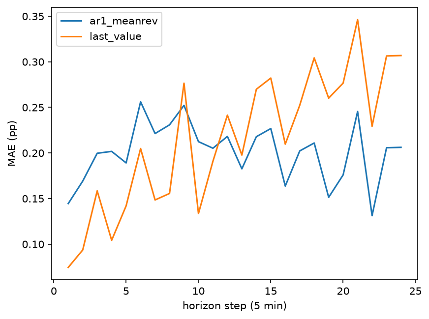
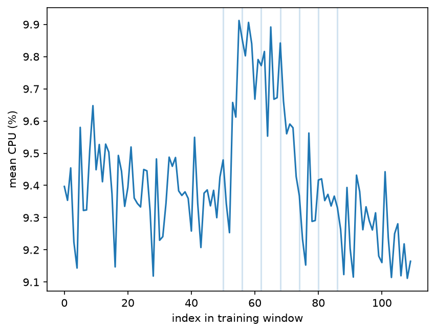

# Forecasting Azure VM Workload

Prachi | Atomity AI/ML take-home | October 2026

Everything in this report can be regenerated with the commands in the README. CPU values are
percentages, and "pp" means percentage points.

## 1. Executive summary

The main finding is that this fleet is very stable. Across the 110 training timestamps, the
mean CPU of the 10,000 VMs stays around 9.4% and moves with a standard deviation of only
0.19 pp. The other target, the number of active VMs, is exactly 10,000 at every timestamp, so
there is nothing to forecast there. Section 2 explains why.

For CPU, the model I selected is an AR(1) that reverts to the mean. On the final two hours it
scored an MAE of 0.153 pp and an RMSE of 0.183 pp, which is about 1.7% error relative to the
level. Persistence (repeating the last value) scored 0.147 and 0.185. The model is slightly
worse on MAE and slightly better on RMSE, and I treat that as a tie.

The tie is not what validation suggested. Inside the training window the AR(1) beat
persistence by 6.7% in MAE, but it won only 3 of 7 folds, and the holdout shows that the gap
was mostly noise. Put simply, with 11 hours of history none of the methods I tried, including
ARIMA and a ridge regression on lagged values, reliably beats persistence. Persistence is
best for the next few steps, and mean-reverting models do better further out.

For capacity planning I would cap capacity at the larger of the model forecast and the last
observed value, plus a margin equal to the 90th percentile of validation errors. That margin
is about 0.3 pp, or 3.4% of the load. Latency-sensitive VMs should use the 95th percentile. A
margin this small only protects the fleet average, though. The real risk sits in a small group
of very hot VMs, so the 95th percentile VM load and the share of VMs above 80% should be
monitored alongside the forecast.

## 2. Data understanding and preprocessing

The release has 1,340,000 readings: 10,000 VMs with 134 readings each, spaced 300 seconds
apart (timestamps 0 to 39,900 seconds from the start of the trace). Before modeling I checked
the basics.

| Check | Result |
|---|---|
| Shape | 1,340,000 readings, 10,000 metadata rows |
| Timestamp grid | 134 unique timestamps, 133 gaps, all exactly 300 s |
| Duplicate (VM, timestamp) pairs | 0 |
| Missing values | none in readings or metadata |
| Value ranges | CPU between 0 and 99.7; min <= avg <= max in every row |
| VMs per timestamp | exactly 10,000 everywhere; every VM has exactly 134 rows |

`active_vm_count` at time t is the number of distinct VM ids with a valid `avg_cpu` reading.
`aggregate_cpu_utilization` is the mean of `avg_cpu` over those VMs, clipped to [0, 100]. If
a reading were missing I would drop it before averaging rather than fill it in, but this
release has none. I built the full 134-point series first and only then split it into 110
training and 24 holdout points. I model at the native 5-minute cadence, so there is no mapping
back from a coarser one.

The constant VM count comes from how the data was built. Every VM has a creation time of 0,
meaning it already existed when observation began, and the earliest deletion in the metadata
is at 40,500 s, one step after the last reading. At least half the VMs have a deletion time of
2,591,400 s, the end of the 30-day upstream trace. Because only VMs with complete traces were
kept, the churn a real fleet would show has been removed. This target carries no information
here, and I would not read anything about real fleets into it.

Some metadata columns (`avg_cpu`, `max_cpu`, `p95_max_cpu`, `timestamp_vm_deleted`) summarize
the full 30 days, which includes the holdout period. I did not use them as features or to
define segments. I only used the static columns `vm_category`, `virtual_core_bucket` and
`memory_gb_bucket`.

## 3. Workload analysis

Over the training window the aggregate has a mean of 9.41%, a standard deviation of 0.19 pp,
and a range of 9.11 to 9.91. It is not pure noise. There is a clear hump around indices 50 to
66 (about 15,000 to 20,000 s) that peaks at 9.91 at 16,500 s, and the series then slides to
its lowest values near the end of the window. The autocorrelation is 0.67 at lag 1, 0.61 at
lag 2 and 0.48 at lag 6 (30 minutes), and it fades to roughly zero by lag 10 to 15. That
looks like a stable level with deviations that die out, which is why I tried mean-reverting
models. In practice a fleet-mean swing of well under 1 pp is too small to justify capacity
changes by itself.

The picture changes when you look at individual VMs. Across readings, `avg_cpu` has a median
of 5.1%, a mean of 9.4%, a 75th percentile of 9.6% and a maximum of 99.5%. Most VMs are
lightly used, and a small group runs close to saturation, visible as the bump at 90 to 100%
in the histogram. The mean hides exactly the VMs that cause capacity and performance
problems.

The tail also moves more than the mean does. Reading the figure, the 95th percentile VM load
swings between roughly 34% and 41%, and the share of VMs above 80% stays around 1.1 to 1.4%.
In relative terms those swings are far larger than the movement in the fleet mean, so a team
that watches only the mean forecast would miss them.

Segments, using the training window and only static metadata:

| Segment | VMs | Mean CPU (%) |
|---|---|---|
| Delay-insensitive | 6,180 | 8.26 |
| Interactive | 3,091 | 11.51 |
| Unknown | 729 | 10.35 |
| 2 vCPU | 7,534 | 9.76 |
| 4 vCPU | 1,908 | 7.92 |
| 8 vCPU | 486 | 9.66 |
| 24 vCPU | 62 | 11.43 |
| more than 24 vCPU | 10 | 6.62 (too few VMs to interpret) |

Interactive VMs run the hottest. They are about 31% of the fleet but roughly 38% of aggregate
CPU. They are also the latency-sensitive group, which is why I suggest a larger margin for them
in section 8. In the segment plots, the Delay-insensitive curve shows a bump during the hump
described above, so that group seems to account for much of the aggregate movement.

The peak of the aggregate (index 55) sits inside the hump and the low point is at the end of
the training window. Both matter later, because several validation folds start near the hump
and forecasts anchored to either level struggle there.

## 4. Forecasting approach

The series moves by about 0.2 pp and I have 110 points, so I kept the models small. A
seasonal model makes little sense with 11 hours of data. I tried these candidates, and each
one estimates its parameters only from the history it is given:

- Baselines: last value, moving averages over 6, 12 and 24 steps, the expanding mean, EWMA
  with 0.1 and 0.3, drift, and seasonal-naive with periods 12 and 24.
- AR(1) with mean reversion: the forecast is `mu + phi^k * (last value - mu)`, with `mu` and
  `phi` estimated from the history and `phi` clipped to [0, 0.99].
- A direct version of AR(1) with a separate coefficient for each horizon step.
- ARIMA(1,0,1), which falls back to the mean if the fit fails.
- Ridge regression, one model per horizon step, on lagged deviations from the mean (lags 0,
  1, 2, 5 and 11) and a 6-point rolling mean.

Every feature is computed from observations up to and including the forecast origin. I did
not use calendar features. The timestamps are seconds since the start of the trace, so I do
not know the real time of day, and 11 hours is too short to learn an hourly or weekly pattern
anyway. The two targets are forecast separately. For the constant count every candidate has
zero error, and persistence wins the tie.

To pick a model I take the lowest rolling-origin RMSE, but if several models are within 2% of
the best I take the simplest. I committed to this rule before the last two candidates (direct
AR(1) and ARIMA) were scored, because with seven overlapping folds the ranking among close
models is mostly noise.

## 5. Validation methodology

I used rolling-origin evaluation on the 110 training points only, with a horizon of 24. The
origins are 50, 56, 62, 68, 74, 80 and 86, so there are seven folds. At each origin the model
sees only the data before it and is scored on the next 24 points. The last fold ends exactly
at index 110, so the holdout never enters a fold, a fit, a tuning decision or the selection.
This matches how a forecast would be used in production: forecast two hours ahead, again and
again, from whatever history exists at that moment. Nothing is shuffled, and the baselines go
through the same evaluation code as the models.

The folds overlap heavily (step 6, horizon 24), so they are far from independent. The best of
14 candidates on seven folds is also an optimistic estimate of that candidate's skill. For
that reason I treat the holdout, scored once after everything was frozen, as the real test.

To guard against leakage I split before fitting anything, left out the whole-trace metadata
columns, and added a test that overwrites the holdout readings with extreme values and checks
that the predictions do not change. One more thing to disclose: early in the exploration I
printed some statistics over the full 134-point series, including the holdout mean. No
modeling, selection or policy decision used them.

## 6. Results versus baseline

Validation results for CPU (rolling origin, horizon 24, errors in pp):

| Model | MAE | RMSE | MAE vs persistence |
|---|---|---|---|
| Last value (baseline) | 0.2152 | 0.2715 | 0.0% |
| Expanding mean (baseline) | 0.2088 | 0.2447 | +3.0% |
| AR(1) mean reversion (selected) | 0.2009 | 0.2373 | +6.7% |
| Direct AR(1) | 0.1967 | 0.2339 | +8.6% |
| ARIMA(1,0,1) | 0.1973 | 0.2368 | +8.3% |
| Ridge on lags | 0.2220 | 0.2581 | -3.1% |
| Moving average (6 / 24) | 0.2428 / 0.2774 | 0.2904 / 0.3079 | -12.8% / -28.9% |
| Seasonal-naive (12 / 24) | 0.2717 / 0.3182 | 0.3203 / 0.3576 | -26.2% / -47.8% |

The top three models are within about 2% of each other, which is well inside the variation
between folds (persistence has a per-fold MAE anywhere from 0.087 to 0.301). The selection
rule therefore picked the simplest of them, AR(1). Most candidates beat persistence in only 3
of the 7 folds.

Final holdout (24 timestamps, 2 hours, model frozen before scoring, scored once):

| Target | Model | MAE | RMSE | Baseline MAE | Baseline RMSE |
|---|---|---|---|---|---|
| `active_vm_count` | last value | 0 | 0 | 0 | 0 |
| `aggregate_cpu_utilization` | AR(1) mean reversion | 0.1533 | 0.1832 | 0.1468 | 0.1848 |

For CPU the other holdout numbers are an sMAPE of 1.65% (the 1e-8 guard on the denominator
never matters because the actuals are around 9%), a MASE of 1.27 (scaled by the training
one-step naive error, so values above 1 are expected at a 24-step horizon), and a mean signed
error of -0.124 pp, meaning the forecast was too high on average. Against persistence the MAE
is 4.5% worse and the RMSE 0.9% better. On this holdout the model is not better than the
baseline.

## 7. Error and failure analysis

Persistence is the most accurate method at the shortest horizons, with an MAE of 0.074 at
step 1 against 0.144 for the AR(1), and it gets steadily worse, reaching 0.307 at step 24. The
mean-based models are flat at about 0.21. The AR(1) is a compromise: weaker than persistence
at step 1 and no better than the plain mean at step 24. The curves are jagged because there
are only seven folds.

The fold results show where things go wrong. Persistence has a per-fold MAE of 0.27 to 0.30 in
the first four folds and 0.09 to 0.13 in the last three, while the mean-based model shows the
opposite pattern. The early folds start near the hump, where a forecast that reverts to the
history mean is anchored to the old level and persistence copies a temporary rise.

The most important failure is at peaks. For the highest 10% of actual values in validation
(17 of 168 pooled points), the model's MAE is 0.428 pp against 0.221 pp for persistence, and
the mean signed error equals the MAE, so essentially every peak point is under-forecast. Mean
reversion pulls forecasts toward the middle, which means it is wrong in the dangerous
direction when load is highest. The peak set is small and built from overlapping windows, so
I treat this as a strong hint and not a precise number.

The holdout behaved differently. Its mean (9.27%) was below the training mean (9.41%), and the
training window ended near its lowest values. A forecast that reverts toward 9.41% therefore
came out too high (-0.124 pp on average), while persistence stayed close to the low level.
That is consistent with the data, but one window cannot prove it. The holdout had no clear
peak, so it did not test the under-forecasting problem; its error on the top 10% of points is
0.108 pp.

Ridge regression on lags was worse than persistence by 3% in MAE. With about 100 points and
six features per horizon step, it fits noise, and I report that rather than tuning it away.

An 80% band from pooled validation residual quantiles covered 76% of validation points, which
is optimistic because the band was estimated on the same folds. On the holdout it covered 83%
(20 of 24 points). With 24 strongly autocorrelated points, neither number shows that the band
is calibrated.

## 8. Capacity-planning recommendation

My recommendation is a cap of `max(model forecast, last observed value) + margin`, where the
margin is a pooled quantile of validation forecast errors. The 90th percentile is the
default, and the 95th is for latency-sensitive (Interactive) workloads. I would add a tail
layer on top: watch the 95th percentile VM load and the share of VMs above 80%, and scale up
when either leaves its normal range, whatever the mean forecast says.

The table shows the trade-off in validation for a cap of model forecast plus margin.

| Margin quantile | Margin (pp / % of level) | Miss rate | Peak miss rate | Mean shortfall (pp) | Mean spare (pp) |
|---|---|---|---|---|---|
| 0.50 | -0.06 / -0.7% | 50.0% | n/a | 0.116 | 0.065 |
| 0.80 | 0.19 / 2.0% | 21.4% | 88.2% | 0.030 | 0.232 |
| 0.90 | 0.32 / 3.4% | 11.9% | 70.6% | 0.010 | 0.337 |
| 0.95 | 0.38 / 4.1% | 7.1% | 58.8% | 0.004 | 0.399 |

Going from the 0.80 to the 0.90 quantile adds 0.105 pp of spare capacity and removes two
thirds of the average shortfall. Going from 0.90 to 0.95 adds another 0.062 pp for only 0.006
pp less shortfall, so each unit of protection costs about twice as much. The 0.90 quantile
sits at the knee of the curve. I lean toward the higher quantile for latency-critical work
because under-provisioning (throttling, latency, SLA breaches) is severe and unbalanced,
while over-provisioning is a bounded cost.

A margin calibrated on all points does not protect the peaks. Even at the 0.95 quantile, the
model-only cap is exceeded at 59% of the peak points. Taking the larger of the model forecast
and the last observation, the one variant I specified in advance, brought the peak miss rate
down to 53% at the 0.90 quantile and 41% at 0.95. At the 0.90 quantile it also uses less
spare capacity than the model-only cap at 0.95 (0.376 against 0.399 pp), though the average
shortfall is slightly larger. It still does not cover peaks fully, which is why the tail
monitoring is part of the recommendation.

On the holdout, neither the model-only cap nor the max rule at the 0.90 quantile was exceeded.
Since the forecast ran high, the average spare capacity of the model-only cap was about 0.44
pp (the 0.32 pp margin plus the 0.12 pp over-forecast), roughly 4.7% of the fleet-mean load.
The holdout therefore shows the over-provisioning side of the trade-off, but contained no peak
to test the under-provisioning side.

## 9. Limitations and future work

- Eleven hours of data cannot show daily or weekly seasonality, so the conclusions are about
  short-term persistence and mean reversion only.
- I scored 14 candidates on seven overlapping folds, so the winner is uncertain. The holdout
  has 24 correlated points and cannot rank models that differ by a few percent. The
  validation score of the selected model is optimistic.
- The margins and bands were estimated and evaluated on the same folds, so real miss rates
  are probably higher than shown.
- The dataset only contains VMs with complete traces, so there is no churn, and the count
  forecast says nothing about a real fleet.
- The fleet mean hides the tail. I recommend monitoring the tail but did not forecast it.

With more time I would forecast the 95th percentile load and the hot-VM share directly, build
segment-level forecasts for Interactive and Delay-insensitive VMs and add them up, use a
longer window to learn daily seasonality, and use conformal intervals to get proper
out-of-sample coverage. I would also try reverting toward a recent mean instead of the
whole-history mean, since the level shift near the hump is where the current model suffers,
and compare against another public trace such as Google ClusterData2019.